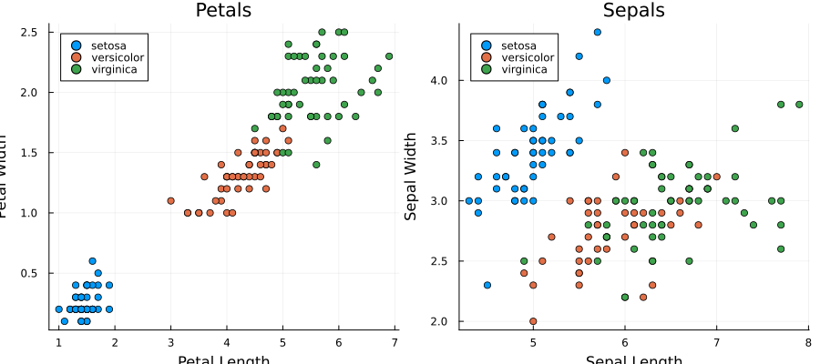
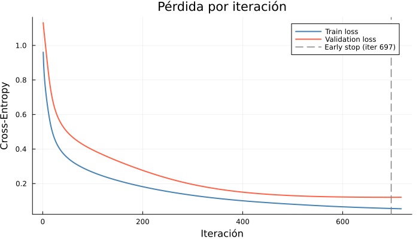

# Neural Network & Gradient Descent

One-hidden-layer neural network (ReLU + softmax) implemented from scratch in Julia, trained on [Iris](https://archive.ics.uci.edu/ml/datasets/iris) with gradient descent, backpropagation and early stopping.

## Run

```bash
julia --project main.jl
```

Prints the test accuracy and saves `iris.png` and `loss.png`.

## Files

- `main.jl`: data loading, training and evaluation.
- `neural_network.jl`: model, forward pass, backpropagation and loss.
- `gradient_descent.jl`: `Optimizer` type, `GradientDescent` and `train!`.
- `utils_tools.jl`: split, standardization and one-hot encoding.
- `evaluation.jl`: `predict`, `accuracy` and the loss plot.




## To do

- [ ] Armijo line search
- [ ] Nonlinear conjugate gradients (Fletcher–Reeves)
